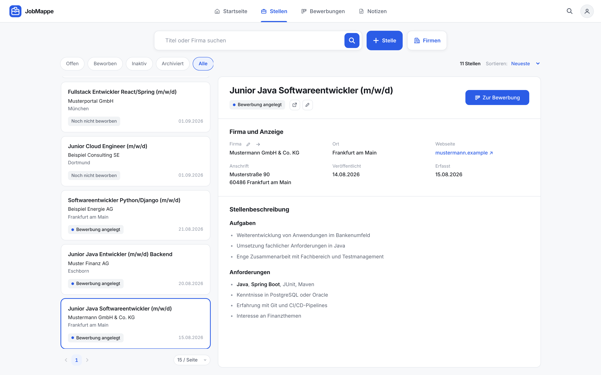
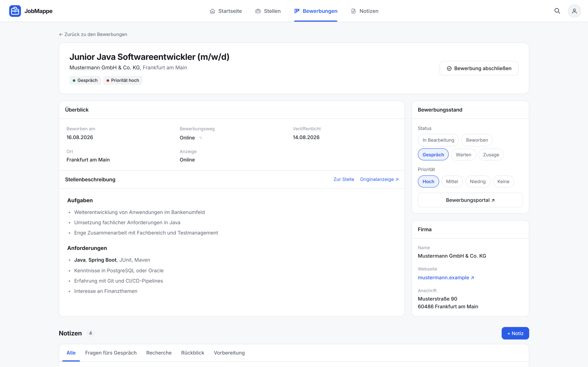

<p align="center">
  <picture>
    <source media="(prefers-color-scheme: dark)" srcset="./public/logo-mark-dark.svg">
    
  </picture>
</p>

<h1 align="center">JobMappe — Frontend</h1>

<p align="center">
  <strong>A job-application tracker for the German job market</strong><br>
  Job postings, companies, applications and notes in one place, from the first draft to the final answer.<br><br>
  <a href="#getting-started"><strong>Getting started</strong></a> ·
  <a href="#ai-assisted-development"><strong>AI-assisted development</strong></a> ·
  <a href="https://github.com/hakikafetzi/jobmappe"><strong>Backend (Spring Boot)</strong></a>
</p>

<p align="center">
  
  
  
  
  
  <br>
  
  
  
</p>

---


## About

JobMappe keeps a job search in one place: the postings you found, the companies behind them, where each application stands and the notes you take along the way. This repository contains the web frontend; it talks to a separate [Spring Boot REST API](https://github.com/hakikafetzi/jobmappe). The user interface is in German.

I built JobMappe for my own job search and as a learning project: to work with a modern React and TypeScript stack, and to find out how far I can take a real application with an AI coding agent while keeping control of scope, design and quality. How that worked is described in [AI-assisted development](#ai-assisted-development).

> All screenshots show fictional sample data.

## Table of contents

- [Screenshots](#screenshots)
- [Features](#features)
- [AI-assisted development](#ai-assisted-development)
- [Tech stack](#tech-stack)
- [Architecture](#architecture)
- [Getting started](#getting-started)
- [Scripts](#scripts)
- [Testing](#testing)
- [License](#license)
- [Author](#author)

## Screenshots

| Applications board                                       | Job postings                                   |
| -------------------------------------------------------- | ---------------------------------------------- |
|         |  |
| **Application detail**                                   | **Notes**                                      |
|   |            |
| **Command palette**                                      | **Settings**                                   |
|  |      |

## Features

### Job postings and companies

- Capture postings by hand; filter them (open, with application, inactive, archived, all), search by title or company and sort them.
- Archive and restore postings.
- Company pages with all their postings; postings and companies can be edited.
- Server-side pagination with a selectable page size.

### Applications

- Start an application from any posting.
- Kanban board with drag and drop between statuses, a drop zone for closing an application and "load more" per column.
- Sortable table with status and priority filters, including closed applications; animated switch between board and table.
- Application detail with status, priority, application channel and portal link. Allowed status changes follow fixed rules (e.g. closing asks for the outcome, closed applications can be reopened).
- Applications without a reply for too long are highlighted as overdue.

### Notes

- Notes with user-defined folders (create, rename, delete), optionally assigned to an application.
- Rich-text editor that stores Markdown.
- Floating note windows that can be minimized into a tray, survive a reload and can be popped out into a separate browser window.
- Gallery and table view, search, sorting and pagination.

### Navigation and personalisation

- Command palette (⌘K / Ctrl+K) for pages and actions, and to search postings, applications, companies and notes.
- Keyboard shortcuts (e.g. `N` new posting, `1`–`3` main areas).
- Light, dark or system appearance, animations on/off, default views and a display name for the greeting, all stored per browser.
- Responsive layout with a mobile dock; accessible markup (native dialogs, keyboard navigation, ARIA where needed).

## AI-assisted development

JobMappe was developed with **[Claude Code](https://claude.com/claude-code)**, Anthropic's AI coding agent, as a pair programmer. Most of the code was written by the AI; I set the direction, made the decisions and reviewed the results.

### My role

- **Product and concept**: the idea, the requirements, the feature scope and the UX design of the screens.
- **Architecture and rules**: the tech stack, the project structure, the API contract between frontend and backend, and the project rules the agent works by.
- **Steering and review**: breaking the work into tasks, reviewing the changes, deciding between alternatives and testing the app.

### How the workflow is set up

- **Project rules in [`CLAUDE.md`](CLAUDE.md)**: product rules (e.g. only build what the API supports, never filter on the client), architecture, conventions and error handling. The agent reads this file in every session, so decisions are made once and applied consistently.
- **Tests as guardrails**: an in-memory fake backend that mirrors the API, served through MSW, lets every feature be tested against real HTTP requests, validation errors and conflicts.
- **One quality gate**: `npm run check` (format, lint, type-check and build, tests) has to pass before every commit.
- **Strict tooling**: TypeScript in strict mode with `noUncheckedIndexedAccess` and Oxlint (including accessibility rules) catch many mistakes before review.

### What I learned

Working with an AI agent is fast, but only as good as its guidance: clear written rules, small well-defined tasks and automated checks matter more than long prompts. The agent speeds up the implementation; responsibility for the scope, the design decisions and the quality of the result stays with me.

## Tech stack

| Area         | Tools                                                                                                 |
| ------------ | ----------------------------------------------------------------------------------------------------- |
| UI           | [React 19](https://react.dev), [TypeScript](https://www.typescriptlang.org) (strict)                  |
| Build        | [Vite 8](https://vite.dev)                                                                            |
| Routing      | [React Router 8](https://reactrouter.com) (data router, lazy-loaded routes)                           |
| Server state | [TanStack Query 5](https://tanstack.com/query)                                                        |
| Styling      | CSS Modules with shared design tokens (light and dark theme)                                          |
| Testing      | [Vitest](https://vitest.dev), [Testing Library](https://testing-library.com), [MSW](https://mswjs.io) |
| Code quality | [Oxlint](https://oxc.rs), [Prettier](https://prettier.io)                                             |
| Development  | [Claude Code](https://claude.com/claude-code) (AI-assisted, see [above](#ai-assisted-development))    |

## Architecture

```text
src/
├── app/        App shell, router, providers, path builders, global hotkeys
├── api/        One module per resource: endpoints, query/mutation hooks, DTO types
├── domain/     Enum labels and colours, allowed status transitions
├── features/   Pages and feature components: postings, applications, notes,
│               categories, home, settings, command palette
├── shared/     Design-system components, editor, hooks, theme, settings, utilities
├── styles/     Design tokens (light and dark) and base reset
└── test/       Fake backend, MSW setup and render helpers
```

Key decisions:

- **The server does the work.** Lists are paginated, filtered, searched and sorted by the backend; the client never filters or re-sorts a page.
- **The URL is the state.** Filters, search, sorting, page, page size and view live in the query string, so every view can be bookmarked and shared.
- **Central error handling.** The backend returns Spring `ProblemDetail`; the frontend maps status codes and field names to its own German messages and shows them inline or as a toast.
- **Rules in one place.** Status transitions live in a single module (`src/domain/transitions.ts`), which the board, the status pills and the detail page all use.
- **CSS Modules and design tokens.** Every component has its own stylesheet; colours, radii and shadows come from shared tokens with a light and a dark set.

## Getting started

### Prerequisites

- [Node.js](https://nodejs.org) 22 or newer and npm
- The [JobMappe backend](https://github.com/hakikafetzi/jobmappe) running on `http://localhost:8080`

### Installation

```bash
git clone https://github.com/hakikafetzi/jobmappe-frontend.git
cd jobmappe-frontend
npm install
```

### Run the app

```bash
npm run dev
```

The app runs on [http://localhost:5173](http://localhost:5173). During development, Vite proxies every request to `/api` to `http://localhost:8080`, so no CORS setup is needed.

### Configuration

| Variable            | Default | Description                                                                |
| ------------------- | ------- | -------------------------------------------------------------------------- |
| `VITE_API_BASE_URL` | `/api`  | Base URL of the API, e.g. when frontend and backend run on different hosts |

### Production build

```bash
npm run build     # type-checks and bundles into dist/
npm run preview   # serves the production build locally
```

## Scripts

| Command                | Description                                                            |
| ---------------------- | ---------------------------------------------------------------------- |
| `npm run dev`          | Start the development server                                           |
| `npm run build`        | Type-check (`tsc -b`) and create a production build                    |
| `npm run preview`      | Serve the production build locally                                     |
| `npm run check`        | Format check, lint, build and unit tests — **run before every commit** |
| `npm test`             | Run unit and component tests once                                      |
| `npm run test:watch`   | Run unit and component tests in watch mode                             |
| `npm run lint`         | Lint with Oxlint                                                       |
| `npm run format`       | Format all files with Prettier                                         |
| `npm run format:check` | Check formatting without writing                                       |

## Testing

Unit and component tests run with Vitest in jsdom (55 test files, 275 tests). Components are rendered against an in-memory implementation of the backend API (`src/test/fake-backend`), served through MSW, so the tests exercise real requests, pagination, validation errors and conflicts without a running backend. Pure logic (URL parsing, sorting parameters, status rules, note layout) lives in plain `.ts` files and is tested on its own.

```bash
npm test
npx vitest run src/features/home/homeText.test.ts   # a single file
npx vitest run -t "<test name>"                     # filter by name
```

## License

[MIT](LICENSE) © 2026 Haki Kafetzi

## Author

**Haki Kafetzi** · GitHub [@hakikafetzi](https://github.com/hakikafetzi)
